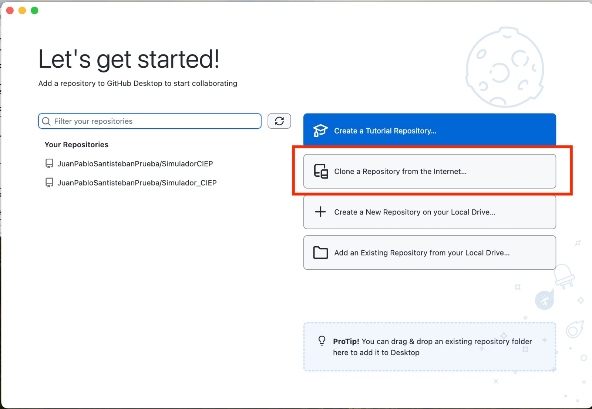
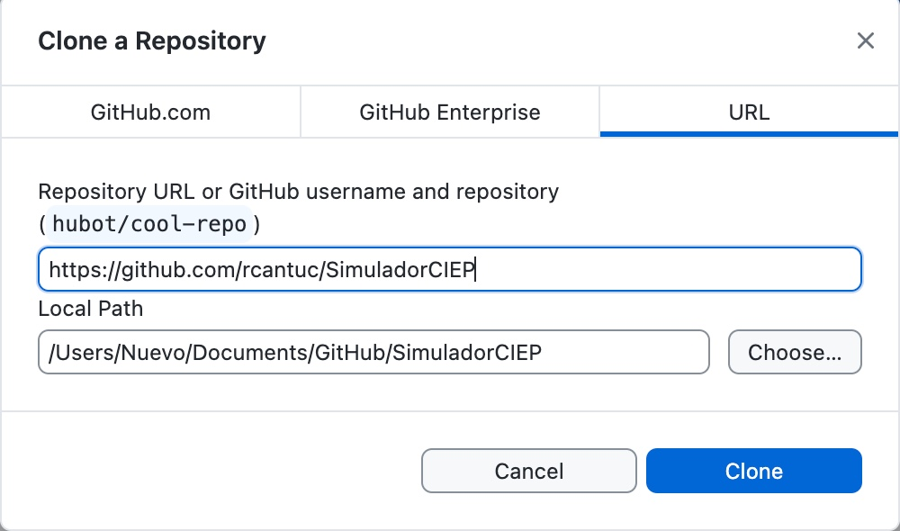
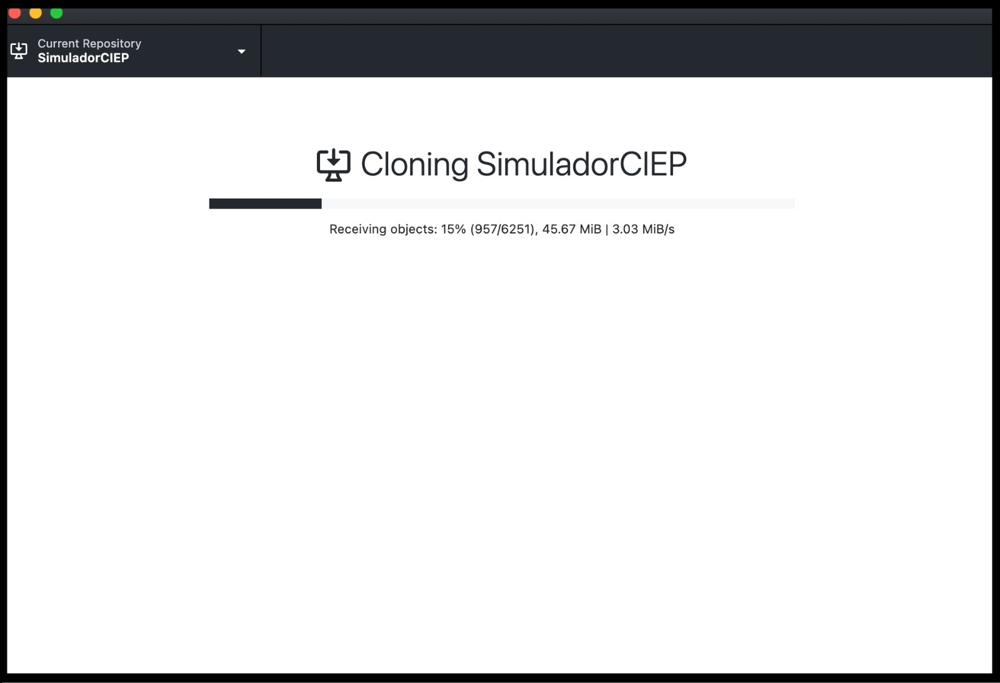

# Simuladores CIEP

Versión: 13 de mayo de 2026

<hr style="border: none; height: 2px; background-color: #ff7020;">

<h2 style="color: #ff7020;">Tres herramientas de simulación fiscal</h2>

El CIEP desarrolla tres simuladores de política pública disponibles en línea para cualquier persona, sin necesidad de instalar nada:

| Simulador | URL | Qué permite simular |
|---|---|---|
| **Simulador Fiscal CIEP** | [simuladorfiscal.ciep.mx](https://simuladorfiscal.ciep.mx) | Proyecciones fiscales de largo plazo: ingresos, gasto, deuda, pensiones y ciclo de vida fiscal |
| **Simulador IEPS al tabaco** | [iepsaltabaco.ciep.mx](https://iepsaltabaco.ciep.mx) | Impacto fiscal y de salud de cambios al IEPS aplicado al tabaco |
| **Simulador de tenencia vehicular** | [tenencia.ciep.mx](https://tenencia.ciep.mx) | Cálculo y análisis del derecho de tenencia o uso de vehículos por entidad federativa |

Los tres son de acceso libre. **Este repositorio** contiene el código fuente del Simulador Fiscal CIEP — el motor de cálculo que corre detrás de `simuladorfiscal.ciep.mx` y que también se puede instalar directamente en Stata. Su arquitectura completa está documentada en [`02_governance/arquitectura.md`](02_governance/arquitectura.md).

Además de la portada (el «Calcular»), el sitio publica dos secciones de **método** que el motor alimenta con sus propios JSON (ningún número nace fuera de Stata; [`02_governance/principio-stata-produce-los-numeros.md`](02_governance/principio-stata-produce-los-numeros.md)):

| Página | Qué muestra | Quién la produce |
|---|---|---|
| [simuladorfiscal.ciep.mx/NTA](https://simuladorfiscal.ciep.mx/NTA) | La cuenta de Transferencias Nacionales (NTA, Lee–Mason) de los hogares por individuo, cerrada en el sector S.14 del SCN: Sankey v3 por grupo de edad en % del PIB, panel grupo × sexo, anclas y residual, y la nota que concilia el hub con el ingreso nacional disponible | `01_modulos/NTA.do` (`SIM.do` §3.2b) → `users/<id>/NTA/` y `users/<id>/SankeyNTA/sankey-v3-grupoedad.json`; gates `test-nta-identidad.sh` y `test-sitio-nta.sh` |
| [simuladorfiscal.ciep.mx/entidades](https://simuladorfiscal.ciep.mx/entidades) y `/entidades/<ABREV>` (las 32) | Por entidad federativa: cinco Sankeys de aportación (quintil estatal, grupo de edad, sexo, rural, escolaridad) con banda de vintages ENIGH y sellos de muestra, ciclo de vida quinquenio × sexo, tasas efectivas por impuesto y el neto del ciclo como % del PIBE | `05_scripts/contrato-32.sh` (`global entidad` del motor para las 32, `contrato-32.do`, `CicloEntidad.do`, `TasasEfectivasEntidad.do`) → `users/<id>/<ABREV>/`; páginas generadas por `generar-entidades.py`; gate `test-sitio-entidades.sh` |

Los memos metodológicos que sustentan esas páginas viven en `02_governance/`: [`nta-0-inventario-2026-10-27.md`](02_governance/nta-0-inventario-2026-10-27.md) (qué hay por persona en el motor y las decisiones de la cuenta NTA), [`conc-1-scn-sankey-2026-10-30.md`](02_governance/conc-1-scn-sankey-2026-10-30.md) (puente SCN ↔ Sankey NTA: INBD 81.6 % del PIB vs hub, cierre de usos, esqueleto de la economía completa), [`contrato-32-2026-10-19.md`](02_governance/contrato-32-2026-10-19.md) (el contrato de entidad para las 32) y [`repro-1-2026-10-28.md`](02_governance/repro-1-2026-10-28.md) (reproducibilidad: por qué el orden de los empates no debe depender del camino).

<h2 style="color: #ff7020;">Simulador Fiscal CIEP</h2>

#### ¿Qué hace el Simulador Fiscal CIEP?

El Simulador Fiscal CIEP facilita el acceso a toda la información económica relevante de México. Con sus programas podrás acceder a gran parte de la información económica pública a través de Stata. Además, el Simulador brinda un pre-análisis y gráficas para facilitar la comprensión de los datos.

<div>
    <p style="margin-bottom: 5px; font-weight: bold;">¿Cuánto tiempo toma acceder a datos del PIB e inflación?</p>
    <div style="display: flex;">
        <div style="flex: 1; padding: 10px;">
            <h2 style="font-size: 14px; font-weight: normal; margin-top: 0; margin-bottom: 5px;">Con el Simulador</h2>
        </div>
        <div style="flex: 1; padding: 10px;">
            <h2 style="font-size: 14px; font-weight: normal; margin-top: 0; margin-bottom: 5px;">Sin el Simulador</h2>
        </div>
    </div>
</div>


<div style="display: flex;">
    <div style="flex: 1; padding: 10px;">
        <ul>
            <li>Tiempo de acceso: 18 segundos</li>
            <li>Base de datos pre-analizada y limpia</li>
            <li>Integración directa con Stata para análisis</li>
        </ul>
    </div>
    <div style="flex: 1; padding: 10px;">
        <ul>
            <li>Tiempo de acceso: más de 1 minuto</li>
            <li>Base de datos cruda</li>
            <li>Sin integración directa a Stata</li>
        </ul>
    </div>
</div>


#### Te lleva un paso más allá

Además de facilitar la descarga de indicadores económicos, el simulador tiene análisis y graficas pre-cargadas que facilitan la interpretación de los datos.

**1. Pre-análisis:** Destaca automáticamente la información más relevante en un formato estructurado, claro y comprensible.

<div style="display: flex; justify-content: center; align-items: center;">
    
</div>


**2. Gráficas:** El simulador proporciona acceso a gráficas que mejoran la comprensión de los datos.

**3. Base de Datos procesada:** El simulador analiza los datos e incorpora indicadores adicionales. Por ejemplo, el programa PIBDeflactor facilita el acceso a datos como el PIB Nominal, PIB Real, PIB per cápita, y PIB por población ocupada, entre otros

<div style="display: flex; justify-content: center; align-items: center;">
    
</div>


<h2 style="color: #ff7020;">Cómo acceder al Simulador Fiscal CIEP</h2>

Hay tres formas de acceder al Simulador Fiscal CIEP según lo que necesitas:

#### Opción A: Sitio web — sin instalar nada

Ve a [simuladorfiscal.ciep.mx](https://simuladorfiscal.ciep.mx) desde cualquier navegador. Sin cuenta, sin instalación. Esta es la opción más rápida para ciudadanos, periodistas y cualquier persona que quiera explorar escenarios fiscales.

#### Opción B: Desde tu propia copia de Stata

Si ya tienes Stata instalado, ejecuta estos dos comandos en la consola de Stata, sustituyendo `LIF` por el nombre del programa que quieres instalar:

```stata
net from https://ciep.mx/simuladorfiscal/
net install LIF
```

Los programas disponibles son: `Poblacion`, `PIBDeflactor`, `SCN`, `SHRFSP`, `LIF`, `PEF`, `DatosAbiertos`, `AccesoBIE`. Una vez instalados, funcionan en tu Stata local igual que en el repositorio completo.

Los datos (insumos oficiales en `raw/`, bases procesadas en `master/`, salidas en `users/`) se guardan en la **carpeta de trabajo** desde la que corres el primer comando (`cd "C:\Proyectos\Simulador"` antes de empezar; pesan varios GB). Para fijar otra carpeta: `global SIMROOT "<ruta>"` antes del primer comando (en el repositorio completo la fija `SIM.do` §0 / `profile.do`).

#### Opción C: Clonar el repositorio completo

Para investigadores del CIEP y quienes quieran explorar el código fuente o contribuir al desarrollo.

#### 1. Instala GitHub Desktop

Ve a la página de [github.com/apps/desktop](https://github.com/apps/desktop) y sigue las instrucciones para instalar GitHub Desktop en tu computadora.

#### 2. Clona el repositorio de SimuladorCIEP en tu computadora.

<details>
  <summary>Instrucciones paso a paso</summary>

1.   Ingresa a la aplicación de GitHub Desktop
2.   Selecciona "Clone Repository from the Internet"
 
 
 <div style="display: flex; justify-content: center; align-items: center;">
    
</div>
 
3. Ingresa el URL `https://github.com/rcantuc/SimuladorCIEP` y haz click en Clone
 <div style="display: flex; justify-content: center; align-items: center;">
    
</div>
4. El repositorio empezará a descargarse en tu computadora
 <div style="display: flex; justify-content: center; align-items: center;">
    
</div>
 
</details>

#### 3. Ya estás listo, verás una carpeta nueva creada en tu computadora.


<h2 style="color: #ff7020;">Programas Disponibles</h2>

Los siguientes comandos de Stata forman parte del Simulador Fiscal CIEP. Están disponibles para cualquier usuario con Stata mediante `net from https://ciep.mx/simuladorfiscal/` (Opción B arriba), y también forman el motor de cálculo que corre detrás de `simuladorfiscal.ciep.mx`.

#### 1. `Poblacion`
Este programa importa los datos de población por edad, sexo y entidad federativa para todos los años de interés. Los datos provienen de la CONAPO. También genera gráficos de la pirámide y transición demográfica para el año de interés.

#### 2. `PIBDeflactor`
Este programa importa y procesa los datos económicos, incluyendo el PIB, el índice de precios implícitos, el INPC, la población y la población ocupada. Genera una base de datos con su deflactor y productividad laboral para todos los años. Los datos provienen del INEGI y BIE.

#### 3. `SCN` (Sistema de Cuentas Nacionales)
Este programa importa y procesa los datos del sistema fiscal, incluyendo los ingresos, gastos y deuda para todos los años. Los datos provienen de las LIFs (Leyes de Ingresos de la Federación), PEFs (Presupuestos de Egresos de la Federación) y SHRFSP (Sistema de Información de las Finanzas Públicas Estatales y Municipales).

#### 4. `SHRSFP` (Saldo Histórico de los Requerimientos Financieros del Sector Público)
Este programa importa y procesa datos del Saldo Histórico de los Requerimientos Financieros del Sector Público desde el año 1993 hasta el año actual. Captura información para evaluar la deuda pública y estructura fiscal. Para este programa se utilizan datos de la SHCP y del INEGI.

#### 5. `LIF` (Ley de Ingresos de la Federación)
Este programa importa y procesa datos sobre los ingresos de la federación, utilizando información oficial de la SHCP y el INEGI. Permite acceder a registros históricos de ingresos fiscales, comparar su evolución a través del tiempo y analizar su elasticidad respecto al PIB.

#### 6. `PEF` (Presupuesto de Egresos de la Federación)
Este programa importa y procesa datos del Presupuesto de Egresos de la Federación (PEF), utilizando datos de la SHCP e INEGI. Permite acceder al gasto público histórico desde 2013 hasta la fecha actual, desglosando la distribución del gasto en sectores como salud, educación y seguridad.

#### 7. `DatosAbiertos`
Este programa está diseñado para proporcionar acceso estructurado a cualquier indicador económico de las Estadísticas Oportunas de Finanzas Públicas, facilitando su consulta y análisis. Para este programa se utiliza información de la SHCP y del INEGI.

<h2 style="color: #ff7020;">Como usar el Simulador Fiscal CIEP</h2>

Para llamar al programa es necesario escribir un comando en la consola de Stata. Cada comando tiene una sintaxis específica y puede incluir *options*, instrucciones específicas que permiten refinar tu búsqueda para adaptarlo a lo que buscas.

Llamar al programa con la sintaxis correcta puede resultar complejo. Por ello, cada programa cuenta con su ayuda oficial dentro de Stata: escribe `help` seguido del nombre del comando (por ejemplo, `help LIF`) para ver su descripción, sintaxis, opciones y ejemplos listos para copiar. Esa ayuda es la fuente única de verdad sobre cada comando. Se recomienda consultarla antes de ejecutar cualquier comando.


<h2 style="color: #ff7020;">Somos tu mejor aliado en la investigación</h2>

Como cualquier herramienta, el proceso de adaptación al Simulador Fiscal CIEP tomará tiempo. Sin embargo, creemos que una vez que pases por esta etapa de aprendizaje no volverás a acceder a los datos públicos de otra manera.

Si deseas que incluyamos nueva información económica o tienes sugerencias para cualquiera de los Simuladores CIEP, no dudes en enviarnos un correo a `ricardocantu@ciep.mx`. Estamos comprometidos en hacer estos simuladores lo más robustos posible y estamos abiertos a todas tus sugerencias.


<h2 style="color: #ff7020;">Cómo citar</h2>

Cada versión publicada deja en su Release de GitHub un **corte de datos citable**: `datos-<versión>.zip` (el escenario default del sitio `output.txt`, los 10 Sankeys, la cuenta NTA `NTA/*`, el Sankey v3 y las 32 carpetas de entidad con `entidades.json`) y `manifest-datos.json` (SHA-256 y bytes por archivo, commit, `data_updated` y los vintages que leyó la corrida tal como los registra el motor). Los empaqueta y verifica `05_scripts/publicar.sh` en cada release (Gate 9); el archivo [`CITATION.cff`](CITATION.cff) de la raíz lleva la versión y la fecha de los datos del manifest (Gate 10; GitHub muestra el botón *Cite this repository*). Cita sugerida:

> CIEP (2026). Simulador Fiscal CIEP v9.0.0, datos al *data_updated*. https://github.com/rcantuc/SimuladorCIEP/releases/tag/v9.0.0

Sustituye la versión y la fecha por las de la Release que usaste (están en `manifest-datos.json` y en `CITATION.cff`). No hay DOI externo: la Release de GitHub, con sus SHA-256, es la referencia.

**Comparabilidad entre versiones:** `manifest.json` y `manifest-datos.json` declaran `baseline`, el tag desde el que los números publicados (escenario default, Sankeys, 32 entidades) son comparables con esa versión; para v8.14.0 y anteriores es `v8.12.4`; desde v8.15.0 es `v8.15.0` (Cuadratura I: `Households.do` re-anclado al sector hogares S.14, CUAD-0 firmado). Si dos versiones tienen el mismo `baseline`, sus números comparan; si no, el CHANGELOG dice por qué (`publicar.sh` lo exige desde v8.15.0 con el Gate 11 y `health.php` lo muestra como `Baseline:`).

<h2 style="color: #ff7020;">Cómo reproducir resultados de una versión específica</h2>

Si necesitas replicar un análisis hecho con una versión anterior del Simulador Fiscal CIEP (por ejemplo, para verificar los resultados de una publicación, revisar un artículo, o comparar cambios entre versiones), este es el proceso:

#### 1. Clona el repositorio y ubícate en la versión deseada

```bash
git clone https://github.com/rcantuc/SimuladorCIEP.git
cd SimuladorCIEP
git checkout v8.0.2   # sustituye por la versión que necesites
```

Puedes ver todas las versiones publicadas en la sección [Releases](https://github.com/rcantuc/SimuladorCIEP/releases) del repositorio.

#### 2. Abre el proyecto en Stata

Al abrir Stata dentro del clon, `profile.do` se ejecuta automáticamente y descarga los datos raw correspondientes a esa versión desde los assets del Release en GitHub. Cada asset se verifica contra el SHA-256 declarado en `05_scripts/manifest.json` de esa versión, garantizando que los archivos son idénticos a los publicados originalmente.

#### 3. Corre `SIM.do`

Los resultados serán equivalentes a los del análisis original.

#### Nota sobre datos que se descargan de APIs

Algunos comandos (como `AccesoBIE` y `DatosAbiertos`) extraen datos en tiempo real de las APIs de INEGI y SHCP. Estas fuentes hacen revisiones estadísticas periódicas a sus series históricas, por lo que valores específicos pueden diferir entre la fecha del análisis original y la fecha de replicación. El Simulador descarga siempre en vivo: el `output.txt` publicado corresponde a las fuentes del día en que se corrió y no se garantiza reproducirlo al byte después (decisión 2026-10-15; [`02_governance/runbook-deploys-ciep.md`](02_governance/runbook-deploys-ciep.md) §9).


---

<h2 style="color: #ff7020;">Documentación Técnica</h2>

Esta sección describe los archivos técnicos del Simulador Fiscal CIEP. La arquitectura completa del ecosistema de Simuladores CIEP — incluyendo la infraestructura de distribución, los roles de gobernanza y los componentes pendientes de implementación — está documentada en [`02_governance/arquitectura.md`](02_governance/arquitectura.md).

### Archivos principales

#### `simulador.stpr`
Proyecto que concentra todos los do-files y ado-files del Simulador Fiscal CIEP.

#### `SIM.do` 
Plantilla maestra (template) para hacer simulaciones fiscales. Configura el entorno, define opciones globales, establece el directorio de trabajo basado en el usuario y ejecuta varios comandos de forma secuencial. Es el flujo **canónico**: el «Calcular» del sitio (`01_modulos/Web.Stata.do`) debe reproducir con los valores default exactamente su `output.txt` (gate `05_scripts/test-web-batch.sh`, 46/46 llaves).

#### `01_modulos/NTA.do`
La cuenta NTA por individuo (§3.2b de `SIM.do`, solo para el año ENIGH anclado al SCN): identidad `C − YL − ImpProd = (τ⁺ − τ⁻) + (YA − S)` por persona, anclas S.14, Sankeys v2/v3 y panel grupo × sexo que dibuja `/NTA`. Parámetros declarados (`nta_anclaS`, `nta_YA`, `nta_cuotas`, `nta_d8`, …) en su encabezado.

#### `profile.do`
Archivo de configuración inicial que se ejecuta automáticamente al iniciar Stata. Realiza las siguientes configuraciones:

**1. Estilo CIEP**
- `set scheme ciep`: Esquema de colores y estilos para gráficos estilo CIEP
- `graph set window fontface "Ubuntu Light"`: Configura la fuente de las ventanas de gráficos
- `set more off, permanently`: Desactiva la pausa en la visualización de resultados largos
- `set type double, permanently`: Define el tipo de dato numérico predeterminado como `double`
- `set charset latin1, permanently`: Establece el conjunto de caracteres para soportar español

**2. Parámetros globales**
- Define el año base para valores presentes (`aniovp`)
- Establece el paquete económico (`anioPE`)
- Determina el año ENIGH más reciente (`anioenigh`)
- Lista de entidades federativas de México

### Opciones globales

- `id`: Variable global con el nombre de usuario actual
- `export`: Directorio donde se guardan las imágenes generadas
- `nographs`: Suprime la generación de gráficos
- `textbook`: Cambia el formato de los gráficos a LaTeX
- `output`: Determina si se generan salidas para la web
- `update`: Determina si se actualizan las bases de datos (toma tiempo); desde v8.8.0 también rehace los cachés micro de `master/<anioenigh>/`
- `entidad`: Nombre exacto de una entidad federativa (catálogo `$entidadesL`, comando `SIMentidad`). Vacío = solo nacional. Con entidad: `Poblacion` de la entidad (§1) y el Sankey del sistema fiscal de la entidad por **quintil estatal** más los cortes grupoedad/sexo/rural/escol en `users/<id>/<ABREV>/` (p. ej. `users/ricardo/NL/sankey-quintil.json`), con banda de vintages ENIGH y sellos de muestra como campos del JSON; los archivos nacionales no cambian. También la gráfica de ciclo de vida de la entidad (`users/<id>/<ABREV>/ciclo-vida.json`, `CicloEntidad.do`). Las reglas (banda 2016-2024, renglones macro por población, cuotas dentro de "Imp al trabajo", sellos n<100 / top1>25 %, series por deciles nacionales) son fijas en el código (runbook §9.7)
- `hasta`: Paro temprano para desarrollo: termina al cerrar la sección indicada (1-7)
- `bootstrap`: Réplicas bootstrap de `Simulador` en los perfiles (`PerfilesSim.do`, `Expenditure.do`, `Households.do`): EE e IC 95 % en el log. Default versionado 250. `PerfilesSim.do` §8 promedia las réplicas en `users/<id>/bootstraps/<bootstrap>/<var>RECprom.dta`, que es lo que lee `FiscalGap` (sin fallback: si falta, aborta con la receta)
- `seed`: Semilla del remuestreo (default versionado 1111, la de `Simulador` desde v1.x). Misma semilla + mismas fuentes = mismo `output.txt`
- `idbase`: Usuario cuyo escenario base lee `FiscalGap` (`users/<idbase>/bootstraps/…`). Local: el propio `id`; `Web.Stata.do` lo fija en `ricardo` (el escenario publicado al VPS por `publicar-vps.sh`)

Los toggles (output, paros tempranos…) se activan descomentando su línea en `SIM.do` §0.4; los scripts batch (`05_scripts/`) los insertan en una copia `SIM_run.do` sin tocar `SIM.do`.

### Estructura del flujo de trabajo

**1. Marco Macro**
- Población (CONAPO): Pirámide y transición demográfica
- Economía (INEGI, BIE): PIB, deflactores, productividad laboral
- Sistema Fiscal: Ingresos (LIF), Gastos (PEF), Deuda (SHRFSP)
- Subnacionales: Datos de gobiernos estatales y municipales

**2. Información de Hogares**
- Procesamiento de ENIGH
- Generación de `households.dta` y `expenditures.dta`
- Integración macro-micro

**3. Ciclo de Vida Fiscal**
- Impuestos y aportaciones por hogar
- Transferencias públicas
- Aportaciones netas
- Cuentas generacionales
- Diagramas de Sankey por grupo demográfico

### Inicio rápido para estudiantes (ZIP de GitHub, sin Git)

1. Descarga el ZIP (`Code → Download ZIP`), descomprímelo donde quieras (queda una carpeta `SimuladorCIEP-master`) y **no la muevas después**.
2. En Stata: `File → Change Working Directory…` y elige esa carpeta (o escribe `cd "ruta/SimuladorCIEP-master"`).
3. Escribe `do "SIM.do"` (o ábrelo con doble clic y pulsa *Do*). La primera vez descarga ~1.3 GB de datos del Release de GitHub y tarda ~1 h; después, ~10 min.
4. Los resultados quedan en `users/<tu usuario>/`. Si SIM.do dice "no encuentro la carpeta del Simulador", repite el paso 2.
5. Para salir de Stata escribe `exit, clear` (no `end`: ese no es un comando de Stata).

### Cómo usar SIM.do

1. Abre el archivo en Stata
2. Modifica las opciones globales según tus necesidades
3. Ejecuta el script completo o por secciones
4. Los resultados se guardan en `users/$id/`

Para más información, consulta el [manual del investigador](03_help/manual-investigador-ciep.md) y la documentación de gobernanza en [`02_governance/`](02_governance/).


